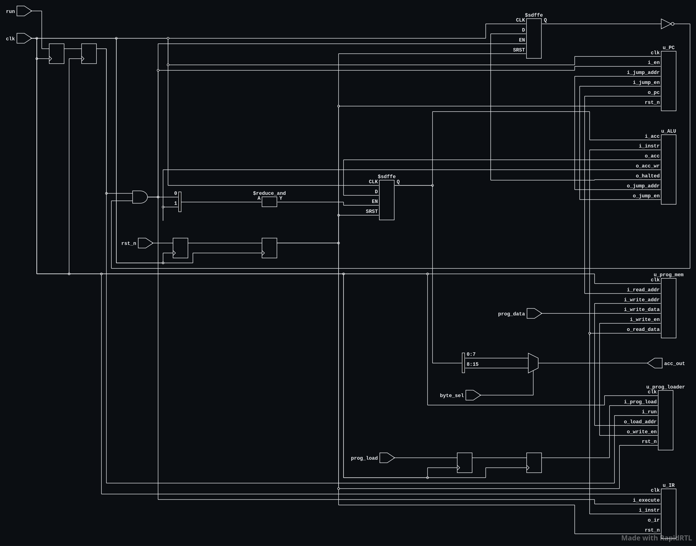
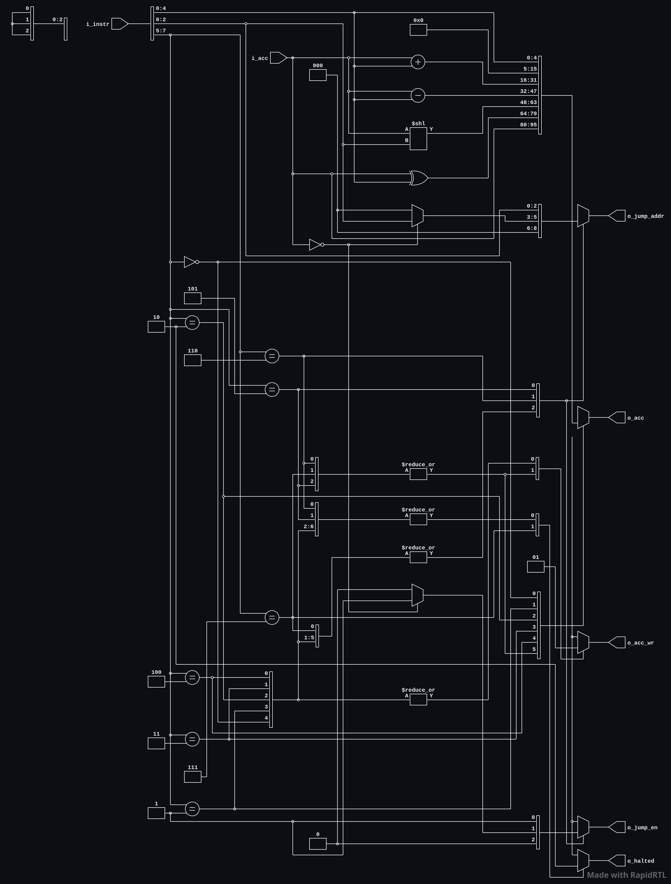
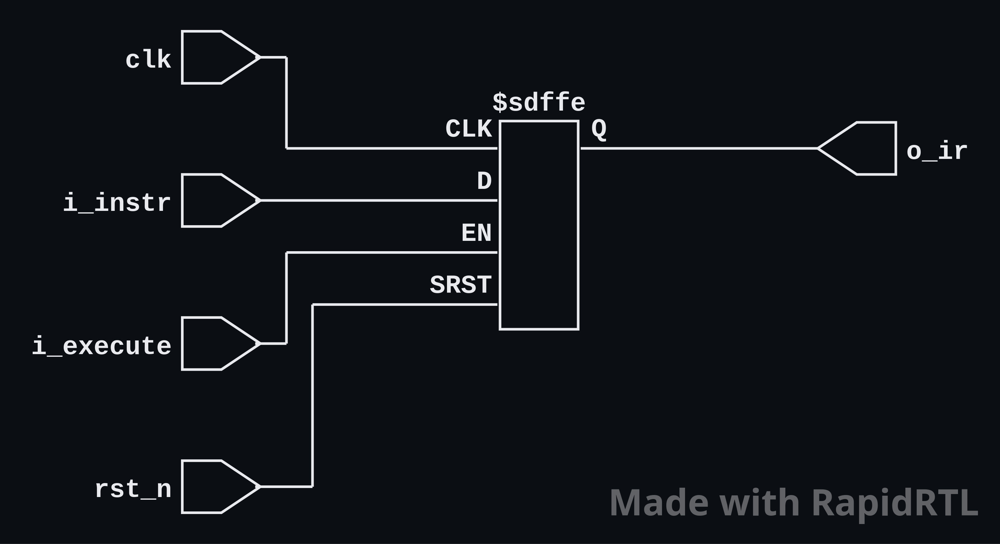
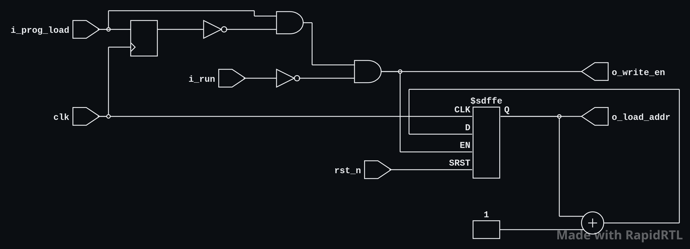
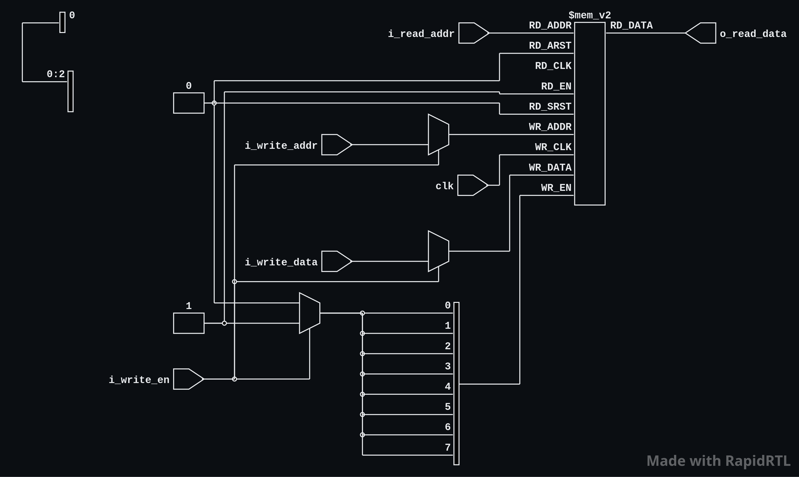

# TCPU-16 design

TCPU-16 is an 8-bit-instruction, 16-bit accumulator CPU with an eight-word
program memory. The RTL implementation is in [`src/`](../src/); the pin-level
programming and result-reading instructions are in the
[project datasheet](info.md).

## Architecture

The Tiny Tapeout wrapper maps `ui_in` to program data, `uio_in[0]` to load,
`uio_in[1]` to run, and `uio_in[2]` to byte select. `uo_out` carries the
selected accumulator byte; `uio_out` and `uio_oe` are tied low.

The CPU consists of:

- **Program memory:** eight 8-bit words, with combinational read at the current
  PC and synchronous writes from the loader. Memory is not reset; all words
  should be loaded before execution.
- **Program loader:** detects a rising edge of synchronized `prog_load` while
  synchronized `run` is low. It writes one byte and advances its 3-bit
  address. Reset returns the address to word zero.
- **ALU / decoder:** combinationally decodes the instruction at the current
  PC, computes an accumulator result or jump decision, and detects HALT.
- **Accumulator:** a 16-bit register updated on an executing edge for LOAD,
  ADD, SUB, SHL, or XOR.
- **Program counter:** a 3-bit register that advances sequentially or loads
  the target for a taken jump. It wraps naturally at the eight-word boundary.
- **Instruction register:** records the instruction on each executing edge
  for RTL visibility and debugging.
- **Output mux:** selects `acc[7:0]` or `acc[15:8]` combinationally; byte
  selection does not wait for a clock edge.

### Instruction encoding

The opcode is `instruction[7:5]`; the unsigned five-bit operand is
`instruction[4:0]`.

| Opcode | Instruction | Accumulator / control action |
|---|---|---|
| `000` | `LOAD imm` | `ACC ← zero_extend(imm)` |
| `001` | `ADD imm` | `ACC ← (ACC + imm) mod 65536` |
| `010` | `SUB imm` | `ACC ← (ACC - imm) mod 65536` |
| `011` | `SHL amount` | `ACC ← (ACC << amount) mod 65536`; amount is operand bits `[2:0]` |
| `100` | `XOR imm` | `ACC ← ACC XOR zero_extend(imm)` |
| `101` | `JMP addr` | Set PC to operand bits `[2:0]` |
| `110` | `JZ addr` | Jump if the full 16-bit ACC is zero |
| `111` | `HALT` | Stop execution until reset |

Non-taken JZ and ordinary ALU instructions advance PC by one. A halted CPU
holds its architectural state even if run toggles. Reset clears PC, ACC, IR,
and halted state; program memory contents are retained.

## Input synchronization and edge timing

The implementation synchronizes `run`, `prog_load`, and active-low `rst_n`
through two flip-flop stages. CPU execution uses the synchronized run value
and is disabled after HALT. Consequently, control changes at the pins take
two clock edges to reach the CPU logic. `prog_data` is not synchronized and
must remain stable around the load event. `byte_sel` is purely combinational
and is not sampled.

The loader's edge detector samples `prog_load` on every clock edge, including
reset. A sustained high level therefore writes only once; a later load needs
a low-to-high transition. Writes are blocked while synchronized run is high.
The testbench uses the same shared clock, reset, loading, and sampling
coroutines for RTL and gate-level runs.

## RTL Block diagrams

The following are the diagrams
### Top wrapper

### ALU 

### IR

### PC

### Program loader

### Program memory

### ALU and instruction decode

> Add the generated ALU schematic here.

### Program loader and synchronizers

> Add the generated loader/synchronizer schematic here.

## Iteration notes

- Each independently diagnosable verification-plan case has its own Cocotb
  test. The earlier ALU test grouped F09–F23 in one coroutine, so a failure
  prevented later checks in that group from reporting. Case-level tests make
  failure isolation and waveform capture more useful. Cocotb reports these
  tests using short feature IDs; split checks use `a`/`b` suffixes.
- `test/generate_waveforms.py` runs each Cocotb test independently and writes
  an FST trace with a matching GTKWave save file that selects signals relevant
  to that test.
- Test modules remain grouped by behavior, while shared drivers stay in
  `test/testbenches/coros/bench.py`.
- Gate-level tests use top-level pins because internal hierarchy may not be
  available after synthesis. RTL additionally checks internal architectural
  state when it is present.
- The reference-model test uses a fixed random seed so its generated programs
  and control edges are reproducible.
- Gate level simulation only includes the pins that are connected to top wrapper since internal hierarchy can be changed during synthesis. 
